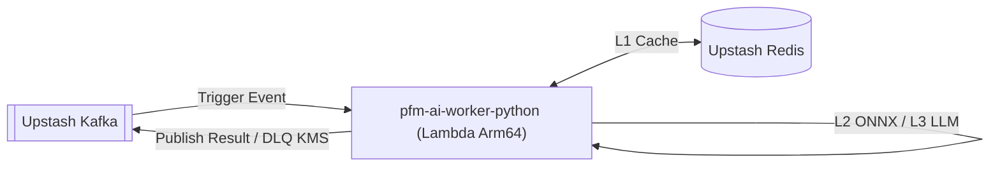

# PFM AI Worker — Python 3.12 Serverless Event-Driven (ADR-009)

[](CONTRIBUTING.md)
[](CHANGELOG.md)
[](https://sorobanerp.github.io/pfm-docs/)

---

## 1. Visão Geral & Papel na Arquitetura

Worker de categorização financeira em **3 camadas** (**L1 Upstash Redis/Regex $\rightarrow$ L2 ONNX Local Arm64 $\rightarrow$ L3 Cloud LLM Anonimizado**) operando como **AWS Lambda Arm64 Event-Driven** (custo \$0 ocioso), **sem conexão direta ao PostgreSQL** e isolado por Arquitetura Hexagonal.

- **Repositório:** `Sorobanerp/pfm-ai-worker-python`
- **Vínculo com `pfm-docs`:** `ADR-001, ADR-004, ADR-009 | US-09, UC-04`



---

## 2. Pré-requisitos & Variáveis de Ambiente

### Pré-requisitos
- Python `3.12+`
- `pytest`, `pytest-cov`, `ruff`, `bandit`

### Variáveis de Ambiente (Sem Segredos Hardcoded)
| Variável | Padrão Local | Descrição |
| :--- | :---: | :--- |
| `WORKER_PORT` | `18400` | Porta HTTP local para healthcheck/testes |
| `REDIS_ADDR` | `localhost:16379` | Upstash Redis (Camada L1) |
| `KAFKA_BROKERS` | `localhost:19092` | Upstash Kafka (Consumo/Publicação) |
| `LLM_PROVIDER_TIMEOUT_MS` | `600` | Timeout máximo da Camada 3 (Circuit Breaker) |

> **Segurança (Zero-Trust):** Nunca commite tokens, senhas, chaves AWS ou strings de conexão com credenciais reais. Utilize `.env` local (ignorado no `.gitignore`) ou AWS Secrets Manager / GitHub OIDC.

---

## 3. Como Executar Localmente

```bash
python3 -m venv .venv && source .venv/bin/activate
pip install -e ".[dev]" || pip install -r requirements.txt
WORKER_PORT=18400 python3 -m uvicorn src.main:app --host 0.0.0.0 --port 18400
```

```bash
cd /home/dantas/workspace/pfm-platform/pfm-ai-worker-python
source .venv/bin/activate
APP_ENV=local PYTHONPATH=. python3 -m src.main --host 0.0.0.0 --port 18400
```

---

## 4. Como Testar e Validar

```bash
pytest --cov=src --cov-fail-under=95 -v
ruff check .
bandit -r src/
```

---

## 5. Como Provisionar / Validar na Nuvem

1. Fluxo Gitflow: `feat/*` $\rightarrow$ `develop` $\rightarrow$ `release/vX.Y.Z` $\rightarrow$ `main`.
2. Implantado via `pfm-ai-worker-infra` em arquitetura `linux/arm64` com custo ocioso zero.

Consulte [CONTRIBUTING.md](CONTRIBUTING.md) para regras de Conventional Commits e [CHANGELOG.md](CHANGELOG.md) para histórico de versões.

---

## Execução e Debug Local (CLI, VS Code e IntelliJ IDEA)

1. **Bootstrap Completo do Ambiente Local (Zero Segredos no Git):**
   Na raiz do workspace (`/home/dantas/workspace/pfm-platform/`), execute:
   ```bash
   ./init-local-development.sh
   ```
   O script gera automaticamente o arquivo `.env.local` (ignorado pelo `.gitignore`, tendo `.env.example` como template seguro), sobe o `pfm-shared-infra/docker-compose.local.yml` (PostgreSQL 16 `:5432`, Kafka/Redpanda `:9092`, Console Kafka `:8081`, Redis/Valkey `:6379`, LocalStack S3+KMS `:4566`), cria os tópicos Kafka e provisiona a chave KMS `alias/pfm-master-key`.

2. **Execução com Perfil `local` & Debug na IDE:**
   - **`pfm-core-ledger-java` (IntelliJ IDEA / Java 25 LTS):** Abra o projeto no IntelliJ IDEA e selecione a Run Configuration compartilhada **`CoreLedgerApplication (local)`** (`.run/CoreLedgerApplication (local).run.xml`, `SPRING_PROFILES_ACTIVE=local`, HTTP `:8082`, gRPC `:9090` com Server Reflection habilitado) ou rode `SPRING_PROFILES_ACTIVE=local ./mvnw spring-boot:run`.
   - **`pfm-ingestion-bff-go` (VS Code / Go):** Pressione **`F5`** (`Run PFM Ingestion BFF (APP_ENV=local :8080)` em `.vscode/launch.json`) e acesse o **Swagger UI (OpenAPI 3.1)** em `http://localhost:8080/swagger/index.html` ou use `requests-local.http`.
   - **`pfm-forecast-engine-go` (VS Code / Go):** Pressione **`F5`** (`Run PFM Forecast Engine (APP_ENV=local :9091 gRPC)` em `.vscode/launch.json`) e teste via `grpcurl -plaintext localhost:9091 list`.
   - **`pfm-ai-worker-python` (VS Code / Python 3.12):** Pressione **`F5`** (`Run PFM AI Worker Python (APP_ENV=local)` em `.vscode/launch.json`), operando em modo determinístico local quando `GEMINI_API_KEY` estiver vazia.
