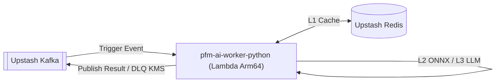

# PFM AI Worker — Python 3.12 Serverless Event-Driven (ADR-009)

[](CONTRIBUTING.md)
[](CHANGELOG.md)
[](https://sorobanerp.github.io/pfm-docs/)

---

## 1. Visão Geral & Papel na Arquitetura

Worker de categorização financeira em **3 camadas** (**L1 Upstash Redis/Regex $\rightarrow$ L2 ONNX Local Arm64 $\rightarrow$ L3 Cloud LLM Anonimizado**) operando como **AWS Lambda Arm64 Event-Driven** (custo \$0 ocioso), **sem conexão direta ao PostgreSQL** e isolado por Arquitetura Hexagonal.

- **Repositório:** `Sorobanerp/pfm-ai-worker-python`
- **Vínculo com `pfm-docs`:** `ADR-001, ADR-004, ADR-009 | US-09, UC-04`



---

## 2. Pré-requisitos & Variáveis de Ambiente

### Pré-requisitos
- Python `3.12+`
- `pytest`, `pytest-cov`, `ruff`, `bandit`

### Variáveis de Ambiente (Sem Segredos Hardcoded)
| Variável | Padrão Local | Descrição |
| :--- | :---: | :--- |
| `WORKER_PORT` | `18400` | Porta HTTP local para healthcheck/testes |
| `REDIS_ADDR` | `localhost:16379` | Upstash Redis (Camada L1) |
| `KAFKA_BROKERS` | `localhost:19092` | Upstash Kafka (Consumo/Publicação) |
| `LLM_PROVIDER_TIMEOUT_MS` | `600` | Timeout máximo da Camada 3 (Circuit Breaker) |

> **Segurança (Zero-Trust):** Nunca commite tokens, senhas, chaves AWS ou strings de conexão com credenciais reais. Utilize `.env` local (ignorado no `.gitignore`) ou AWS Secrets Manager / GitHub OIDC.

---

## 3. Como Executar Localmente

```bash
python3 -m venv .venv && source .venv/bin/activate
pip install -e ".[dev]" || pip install -r requirements.txt
WORKER_PORT=18400 python3 -m uvicorn src.main:app --host 0.0.0.0 --port 18400
```

---

## 4. Como Testar e Validar

```bash
pytest --cov=src --cov-fail-under=95 -v
ruff check .
bandit -r src/
```

---

## 5. Como Provisionar / Validar na Nuvem

1. Fluxo Gitflow: `feat/*` $\rightarrow$ `develop` $\rightarrow$ `release/vX.Y.Z` $\rightarrow$ `main`.
2. Implantado via `pfm-ai-worker-infra` em arquitetura `linux/arm64` com custo ocioso zero.

Consulte [CONTRIBUTING.md](CONTRIBUTING.md) para regras de Conventional Commits e [CHANGELOG.md](CHANGELOG.md) para histórico de versões.
